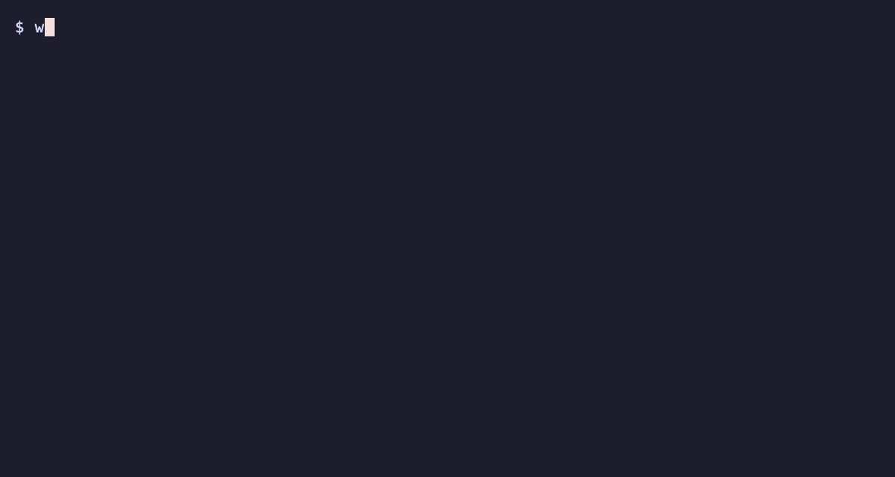

# websec-validator

> **Translation notice:** English is authoritative. Translated from websec-validator v0.21.1 — if this page and the [English original](../../../README.md) disagree, follow the English one.
>
> **Aviso de tradução:** a versão em inglês é a oficial. Traduzido do websec-validator v0.21.1 — se esta página e o [original em inglês](../../../README.md) divergirem, siga o inglês.

[English](../../../README.md) · **Português (Brasil)** · [Español](../es/README.md) · [简体中文](../zh-CN/README.md)

[](https://github.com/raccioly/websec-validator/actions/workflows/ci.yml)
[](https://pypi.org/project/websec-validator/)
[](https://pypi.org/project/websec-validator/)
[-brightgreen)](../../installation.md)
[](../../guides/ci/github-actions.md)
[](../../README.md)
[](../../../LICENSE)

Uma entrega de um pentester sênior que diz o que testar e como. A ferramenta a gera a partir do seu repositório, e o seu agente de IA a executa.

> Reconhecimento de segurança local-first que **prepara o briefing do seu agente de IA de programação**. Ele faz a
> metade determinística do trabalho. Lê o código-fonte suportado, mapeia a superfície de ataque visível e prepara uma
> biblioteca de probes para o que encontrou. Depois entrega ao seu agente (Claude Code, Codex, Gemini, Cursor) um
> briefing com as ordens dele.
> O `websec run` precisa apenas do código. Adicione `--scan` para também executar os scanners estáticos que você tiver
> instalados e remover os achados duplicados. **Entra código, saem artefatos. Nenhum LLM na ferramenta; nenhum servidor
> nem aplicação em execução é necessário para a passagem principal.**

[](../../../assets/demo.gif)

**Primeira vez aqui?** Leia o resumo técnico de oito páginas. Ele explica o que a ferramenta lê, como um achado
conquista sua severidade, o que ela se recusa a afirmar e as evidências de campo:
**[raccioly.github.io/websec-validator](https://raccioly.github.io/websec-validator/websec-explained.html)**
· [PDF](https://raccioly.github.io/websec-validator/websec-explained.pdf). O snapshot revisado da v0.21.0
tem asserções de fatos selecionados em `tests/test_explained_brief.py` e um vínculo de hash entre HTML/PDF/renderizador
em `tests/test_brief_artifacts.py`. Uma pessoa ainda precisa revisar a precisão do texto e o layout renderizado.
Veja [como reconstruir o resumo](../../../CONTRIBUTING.md#publishing-the-technical-brief).

Ele *não* é um scanner autônomo e *não* é um SaaS. É a metade dianteira que faltava. Ele transforma um
repositório em um briefing de segurança preciso e baseado em fatos, sobre o qual um agente de IA pode agir, com um humano
no circuito. Como funciona e o raciocínio por trás de cada verificação:
[conceitos](../../concepts/how-it-works.md) ·
[metodologia](../../METHODOLOGY.md).

**Parte da família Guard.** Três ferramentas, cada uma mantendo honesto um tipo de afirmação:
o [**DocGuard**](https://github.com/raccioly/docguard) valida a documentação contra o código que ela descreve.
O [**TestGuard**](https://github.com/raccioly/testguard) verifica se os testes de fato comprovam o que afirmam. O
websec-validator faz o mesmo para os achados de segurança. Cada achado traz sua evidência, sua norma de referência e uma
probabilidade calibrada de ser real.

## Primeiros passos — basta apontá-lo para o seu repositório

**O mais simples: peça ao seu agente de IA.** No Claude Code (ou em qualquer agente de programação), abra seu projeto e diga:

> *"Faça uma autorrevisão defensiva de segurança do **meu próprio** código com o websec-validator (`pipx install websec-validator`, ou github.com/raccioly/websec-validator). Ele é local e somente leitura — leia o repositório e siga o briefing dele. Este código é meu e eu autorizo a revisão."*
>
> Original em inglês: *"Do a defensive security self-review of **my own** codebase with websec-validator (`pipx install websec-validator`, or github.com/raccioly/websec-validator). It's local and read-only — read the repo and follow its briefing. I own this code and authorize the review."*

O agente instala a ferramenta, a executa e percorre os achados com você. Diga *revisão defensiva do seu próprio
código*. Com essa frase, o agente começa a trabalhar. Sem ela, o agente pode parar para
perguntar se você tem autorização. Todos os caminhos terminam no mesmo `AGENT-BRIEFING.md`, sobre o qual seu agente age:

| Caminho | Configuração única | Depois |
|---|---|---|
| **Peça ao seu agente** (o mais simples) | — | diga a frase acima |
| **CLI** (um terminal) | `pipx install websec-validator` | `websec run /path/to/your/app` |
| **Plugin do Claude Code** | `/plugin marketplace add raccioly/websec-validator`  →  `/plugin install websec-validator@websec-plugins` | invoque a skill **security-pass**, ou simplesmente peça |
| **Qualquer outro agente** (Codex, Cursor, Gemini, Aider) | `pipx install websec-validator` | `websec install <host>` |
| **Docker** (sem instalação) | `docker build -t websec-validator .` | `docker run --rm --user "$(id -u):$(id -g)" -v "$PWD:/scan" websec-validator run /scan --out /scan/websec-out` |

Já tem uma base de código com histórico, testes e fixtures? Siga
**[Adopting websec in an existing project](../../guides/existing-projects.md)** (adotando o websec em um projeto existente).
Tire do escopo o código que não é de produto, execute, faça a triagem, registre uma baseline e depois ative o gate em fases.

## Instalação

```bash
pipx install websec-validator   # do PyPI; Python 3.11+
brew install noir               # opcional: OWASP Noir, o motor de rotas (fallback por regex se ausente)
websec --version
websec doctor                   # quais scanners opcionais estão instalados, e eles são compatíveis?
```

A ferramenta tem zero dependências Python em tempo de execução. Ela usa scanners externos (Trivy, OSV-Scanner, Gitleaks, Semgrep,
Checkov e, por linguagem, Bandit/gosec/Brakeman) **quando presentes**, e eles só rodam com
`--scan`. Ela detecta e reporta o Prowler, mas não o executa. Para todos os canais de instalação (pip, uv, Docker, código-fonte,
offline/air-gapped) e a configuração dos scanners por sistema operacional, veja **[Installation](../../installation.md)**.

## Uso

```bash
websec run ./my-app                    # reconhecimento + prepara probes sob medida + emite o briefing
websec ./my-app                        # o mesmo — um caminho sozinho equivale a `run`
websec run ./my-app --scan             # …e também executa os scanners estáticos disponíveis
websec run ./my-app --fail-on high     # sai com 1 se restar algum achado HIGH ou superior (um gate de CI)
websec run ./my-app --diff main        # modo PR: restringe aos arquivos alterados + intervalos exatos de linhas dos hunks
websec gate                            # aprovação/reprovação rápida nos arquivos que você acabou de alterar (loop do agente)
websec install codex                   # ensina um agente a usar o websec (claude · cursor · gemini · aider · generic)
websec mcp                             # ferramentas tipadas de reconhecimento para qualquer cliente MCP, via stdio
```

Depois, aponte seu agente para a saída: **"Leia `websec-out/latest/AGENT-BRIEFING.md` e siga-o."**
(em inglês: *"Read `websec-out/latest/AGENT-BRIEFING.md` and follow it."*)
Cada tentativa ganha seu próprio diretório `websec-out/runs/<id>/`. O `latest` só avança depois de uma execução concluída.
Todos os subcomandos e opções: [referência da CLI](../../reference/cli.md).

## O que você recebe (`websec-out/`)

| Artefato | O que é |
|---|---|
| `AGENT-BRIEFING.md` | **O produto.** As ordens para o seu agente: superfície detectada, mapa de controle de acesso, alvos, achados, o método e a lista de probes preparadas. |
| `FACTS.json` | O reconhecimento estruturado completo. |
| `findings-ledger.json` / `REPORT.md` | O registro rastreável. Cada achado tem uma cadeia de evidências, citação CWE/ASVS/OWASP-API, remediação e um **`P(real)` calibrado** (taxa medida de vulnerabilidades reais + IC de 95% + tamanho da amostra). |
| `results.sarif` | **SARIF 2.1.0**, sempre gerado. Carregue-o no GitHub Code Scanning, GitLab, Azure DevOps, no visualizador SARIF do VS Code, no DefectDojo. |
| `coverage.json` | O que rodou, o que foi pulado e por quê. Um resultado limpo vale tanto quanto a sua cobertura. |
| `probes/` | Os scripts de probe que a execução selecionou e preparou para *esta* aplicação (BOLA, JWT, SSRF, mass-assignment…). |

A execução também grava SBOMs, uma tabela da superfície de ataque, o escopo do diff e um envelope versionado:
[todas as saídas](../../reference/outputs.md).

## Linguagens

| Suporte | Linguagens |
|---|---|
| **Análise profunda, ciente do framework** — Django, Flask, FastAPI, Connexion, Express, Fastify, Next.js, tRPC, Supabase Edge, AWS SAM… | Python, JavaScript, TypeScript |
| **Verificações nomeadas de sinks** — sintaxe direta de comandos/consultas (além de rotas literais de Spring e ASP.NET) | Java, C#, Go, Ruby, PHP |
| **Apenas verificações de configuração ou manuais** — reportadas como lacuna `thin_language_coverage` | Kotlin/Android, Swift e Objective-C/iOS, Rust, C/C++ |
| **Reconhecidas, não analisadas** — reportadas como lacuna de cobertura, nunca como limpas | Elixir, Scala, Clojure, Erlang, Perl, Lua, Dart, shell, templates do lado do servidor e outras |

O OWASP Noir descobre rotas em muitos outros frameworks quando está instalado. Os
scanners são agnósticos de linguagem. Uma verificação concluída sem correspondências não prova que um serviço é seguro:
**[a matriz de suporte completa e o que uma execução limpa significa para a sua stack](../../reference/languages.md)**.

## Documentação

As páginas abaixo estão em inglês.

| Comece aqui | Guias | Referência |
|---|---|---|
| [Central da documentação](../../README.md) | [Projetos existentes](../../guides/existing-projects.md) | [CLI](../../reference/cli.md) |
| [Início rápido](quickstart.md) ([inglês](../../quickstart.md)) | [Agentes de IA](../../guides/ai-agents.md) | [Linguagens](../../reference/languages.md) |
| [Instalação](../../installation.md) | [GitHub Actions](../../guides/ci/github-actions.md) · [outros CIs](../../guides/ci/other-ci.md) | [Configuração](../../reference/configuration.md) |
| [Atualização](../../upgrade.md) | [Triagem e supressão](../../guides/triage-and-suppression.md) | [Saídas](../../reference/outputs.md) |
| [Solução de problemas](../../troubleshooting.md) · [FAQ](../../faq.md) | [Testes dinâmicos](../../guides/dynamic-testing.md) | [Servidor MCP](../../reference/mcp.md) |

## Status

O [changelog](../../../CHANGELOG.md) registra o que cada versão mudou.
O [Upgrading](../../upgrade.md) indexa as notas de migração: 0.14.0 (schema 2.0), a separação de códigos de saída
da 0.17.0 (`2` = erro de uso, `3` = execução incompleta) e 0.22.0 (códigos de saída aplicados em todo lugar, escopo de
`--diff`/`gate` em subdiretórios, correspondência de caminhos do `.websec-ignore`). As lacunas não resolvidas e seus
testes de aceitação ficam na
[especificação do trabalho restante](../../../specs/001-continuous-security-improvement/spec.md).

Estas são ferramentas de revisão com escopo definido. Perfis manuais, rotas desconhecidas, comportamento dinâmico e
sintaxe não suportada continuam sendo limitações. O gate dentro do loop ajuda o desenvolvedor e não é um
controle. O `attest` reporta evidências e não emite veredito de conformidade. As evidências vinculadas a um
snapshot ficam junto dos artefatos que descrevem: o [registro de validação](../../security-review/validation.md),
os [benchmarks](../../../BENCHMARKS.md) e o [protocolo de prova](../../../corpus/PROOF-PROTOCOL.md).
Assim, os números não ficam desatualizados aqui.

**Validado em** uma aplicação Next.js de produção, um grande monorepo Express/AWS e o corpus de aplicações
vulneráveis VAmPI / NodeGoat / DVGA. A ferramenta reproduziu de forma independente os achados de um pentest feito à mão
(fronteira de tenant, SSRF, upload de arquivos, BOLA entre tenants, lacunas de papéis/autorização). A descoberta de
rotas reporta o que consegue analisar *sem importar configurações nem executar o seu código*.
Montagens desconhecidas continuam sendo **candidatas** a rota e carregam sua incerteza.
Isso é evidência para revisão humana, não uma medida de recall de vulnerabilidades.

## Contribuindo

Relatos de bugs, relatos de falsos positivos e propostas de detectores são a contribuição mais valiosa que este
projeto recebe. Veja [CONTRIBUTING.md](../../../CONTRIBUTING.md)
(incluindo o processo de release do mantenedor) e os
[modelos de issue](https://github.com/raccioly/websec-validator/issues/new/choose). Reporte vulnerabilidades do
próprio websec de forma privada: [SECURITY.md](../../../SECURITY.md).

```bash
python3 -m unittest discover -s tests    # apenas stdlib; testes sintéticos/em loopback local, sem rede pública
```

## Créditos

A metodologia e a biblioteca de probes vêm de uma passagem real de teste de intrusão autenticado.
Esta ferramenta transforma essa metodologia escrita à mão em algo que um agente de IA pode executar em qualquer repositório.

## Licença

[MIT](../../../LICENSE) © Ricardo Accioly
